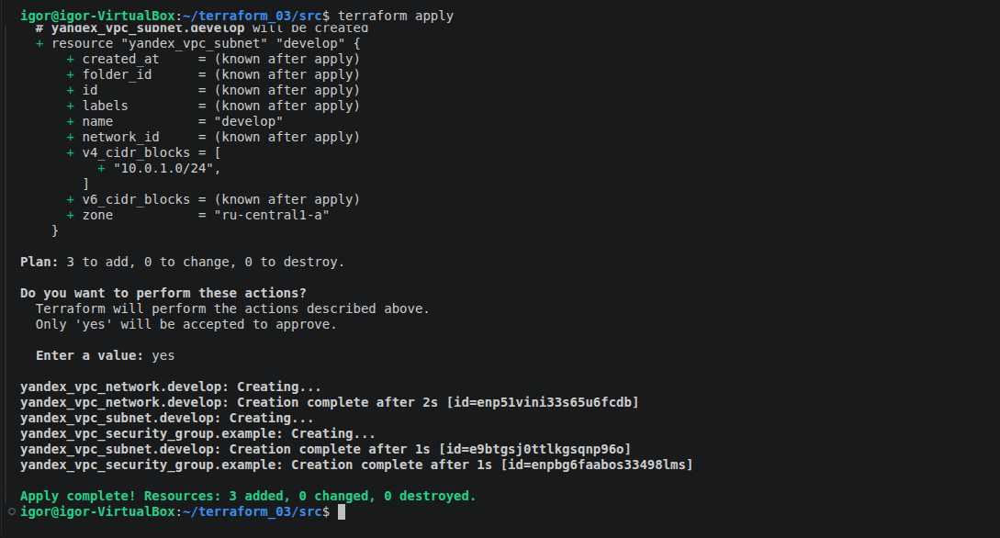
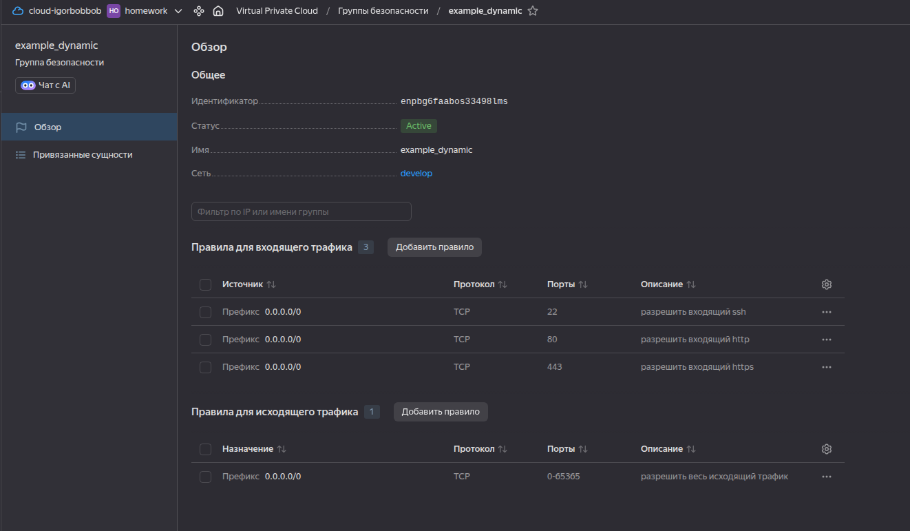
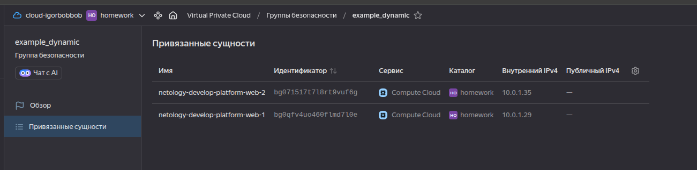
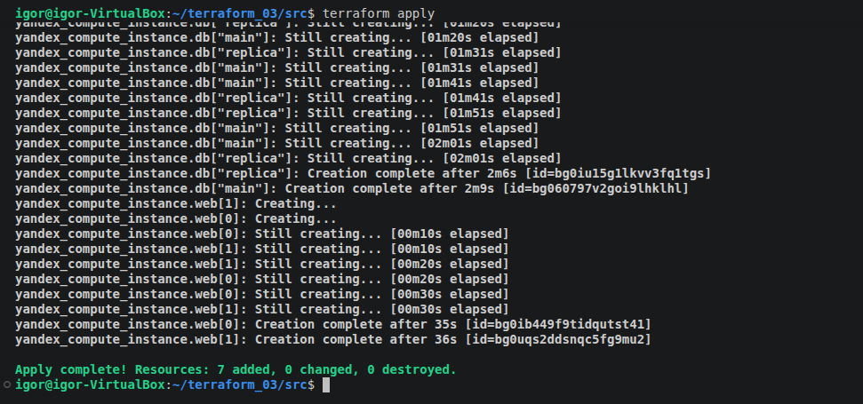
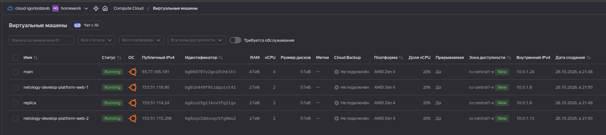
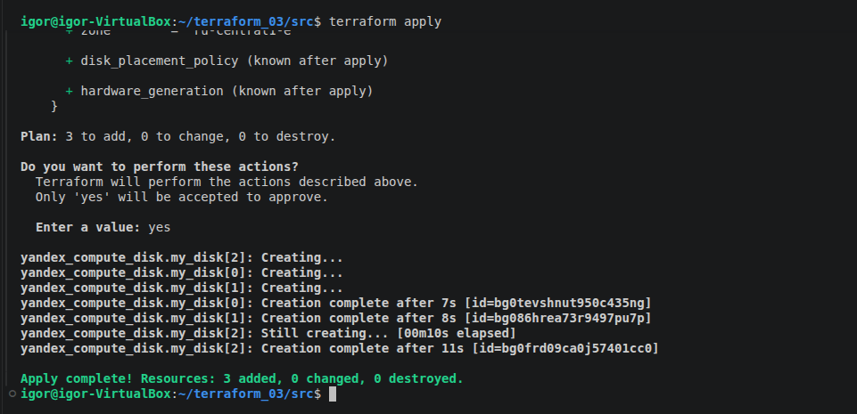
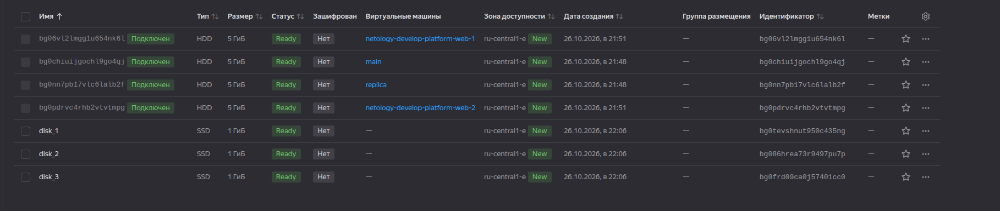
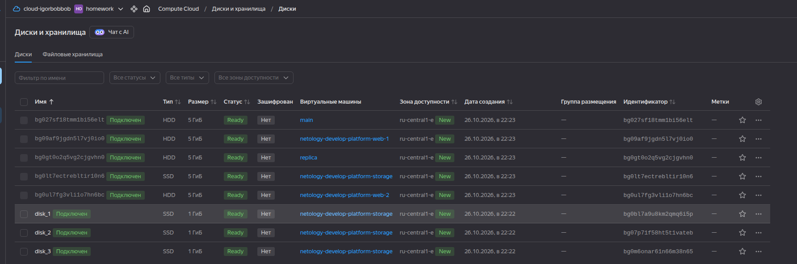
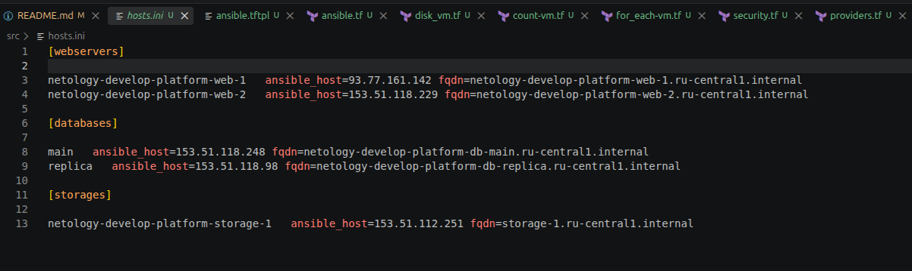

# Домашнее задание к занятию «Управляющие конструкции в коде Terraform»

### Цели задания

1. Отработать основные принципы и методы работы с управляющими конструкциями Terraform.
2. Освоить работу с шаблонизатором Terraform (Interpolation Syntax).

------

### Чек-лист готовности к домашнему заданию

1. Зарегистрирован аккаунт в Yandex Cloud. Использован промокод на грант.
2. Установлен инструмент Yandex CLI.
3. Доступен исходный код для выполнения задания в директории [**03/src**](https://github.com/netology-code/ter-homeworks/tree/main/03/src).
4. Любые ВМ, использованные при выполнении задания, должны быть прерываемыми, для экономии средств.

------

### Внимание!! Обязательно предоставляем на проверку получившийся код в виде ссылки на ваш github-репозиторий!
Убедитесь что ваша версия **Terraform** ~>1.12.0
Теперь пишем красивый код, хардкод значения не допустимы!
------

### Задание 1

1. Изучите проект.
2. Инициализируйте проект, выполните код. 


Приложите скриншот входящих правил «Группы безопасности» в ЛК Yandex Cloud .


### Решение


1. Проект изучен.

2. Проект инициализирован, результат выполнения кода:



Группы безопасности в ЛК Yandex Cloud:




------

### Задание 2

1. Создайте файл count-vm.tf. Опишите в нём создание двух **одинаковых** ВМ  web-1 и web-2 (не web-0 и web-1) с минимальными параметрами, используя мета-аргумент **count loop**. Назначьте ВМ созданную в первом задании группу безопасности.(как это сделать узнайте в документации провайдера yandex/compute_instance )
2. Создайте файл for_each-vm.tf. Опишите в нём создание двух ВМ для баз данных с именами "main" и "replica" **разных** по cpu/ram/disk_volume , используя мета-аргумент **for_each loop**. Используйте для обеих ВМ одну общую переменную типа:
```
variable "each_vm" {
  type = list(object({  vm_name=string, cpu=number, ram=number, disk_volume=number }))
}
```  
При желании внесите в переменную все возможные параметры.
3. ВМ, описанные в файле count-vm.tf, должны создаваться после ВМ, описанных в файле for_each-vm.tf.
4. Используйте функцию file в local-переменной для считывания ключа ~/.ssh/id_rsa.pub и его последующего использования в блоке metadata, взятому из ДЗ 2.
5. Инициализируйте проект, выполните код.

### Решение

1. Файл [count-vm.tf](/src/count-vm.tf) создан, в нем описано создание двух ВМ с помощью аргумента **count loop**. ВМ назанчена группа безопасности ```example```. В ЛК Yandex Cloud видим привязанные к группе безопасности сущности:




2. Создаем [for_each-vm.tf](/src/for_each-vm.tf), в нем описываем создание ВМ с именами "main" и "replica", используя **for_each loop** и переменную "each_vm" в [variables.tf](/src/variables.tf)

3. Добавляем в файл [count-vm.tf](/src/count-vm.tf) конструкцию depends_on, ВМ-web будут созданы после создания ВМ-db

4. Создаем local-перменную ```ssh_public``` в файле [locals.tf](/src/locals.tf) и используем ее в блоке metadata для создаваемых ВМ.

5. Выполняем код:



Все машины успешно созданы:




------


### Задание 3

1. Создайте 3 одинаковых виртуальных диска размером 1 Гб с помощью ресурса yandex_compute_disk и мета-аргумента count в файле **disk_vm.tf** .
2. Создайте в том же файле **одиночную**(использовать count или for_each запрещено из-за задания №4) ВМ c именем "storage"  . Используйте блок **dynamic secondary_disk{..}** и мета-аргумент for_each для подключения созданных вами дополнительных дисков.

### Решение

1. Создаем файл [disk_vm.tf](/src/disk_vm.tf), с его помощью будут созданы 3 диска:



Диски созданы:



2. Создаем в [disk_vm.tf](/src/disk_vm.tf) ВМ c именем "storage", к ней будут подключены три созданных диска:




------

### Задание 4

1. В файле ansible.tf создайте inventory-файл для ansible.
Используйте функцию tepmplatefile и файл-шаблон для создания ansible inventory-файла из лекции.
Готовый код возьмите из демонстрации к лекции [**demonstration2**](https://github.com/netology-code/ter-homeworks/tree/main/03/demo).
Передайте в него в качестве переменных группы виртуальных машин из задания 2.1, 2.2 и 3.2, т. е. 5 ВМ.
2. Инвентарь должен содержать 3 группы и быть динамическим, т. е. обработать как группу из 2-х ВМ, так и 999 ВМ.
3. Добавьте в инвентарь переменную  [**fqdn**](https://cloud.yandex.ru/docs/compute/concepts/network#hostname).
``` 
[webservers]
web-1 ansible_host=<внешний ip-адрес> fqdn=<полное доменное имя виртуальной машины>
web-2 ansible_host=<внешний ip-адрес> fqdn=<полное доменное имя виртуальной машины>

[databases]
main ansible_host=<внешний ip-адрес> fqdn=<полное доменное имя виртуальной машины>
replica ansible_host<внешний ip-адрес> fqdn=<полное доменное имя виртуальной машины>

[storage]
storage ansible_host=<внешний ip-адрес> fqdn=<полное доменное имя виртуальной машины>
```
Пример fqdn: ```web1.ru-central1.internal```(в случае указания переменной hostname(не путать с переменной name)); ```fhm8k1oojmm5lie8i22a.auto.internal```(в случае отсутвия перменной hostname - автоматическая генерация имени,  зона изменяется на auto). нужную вам переменную найдите в документации провайдера или terraform console.
4. Выполните код. Приложите скриншот получившегося файла. 

Для общего зачёта создайте в вашем GitHub-репозитории новую ветку terraform-03. Закоммитьте в эту ветку свой финальный код проекта, пришлите ссылку на коммит.   
**Удалите все созданные ресурсы**.

### Решение

1.  Создаем файлы [ansible.tf](/src/ansible.tf) и [ansible.tftpl](/src/ansible.tftpl) взяв за основу код из лекции [inventory.tf](https://github.com/netology-code/ter-homeworks/blob/main/03/demo/inventory.tf), [hosts.tftpl](https://github.com/netology-code/ter-homeworks/blob/main/03/demo/hosts.tftpl)

2. Инвентарь содержит 3 группы: webservers, databases, storages и обрабатывает всю коллекцию ресурсов.

3. Добавлена переменная  **fqdn**

4. После выполнения кода получаем  файл [hosts.ini](/src/hosts.ini)




